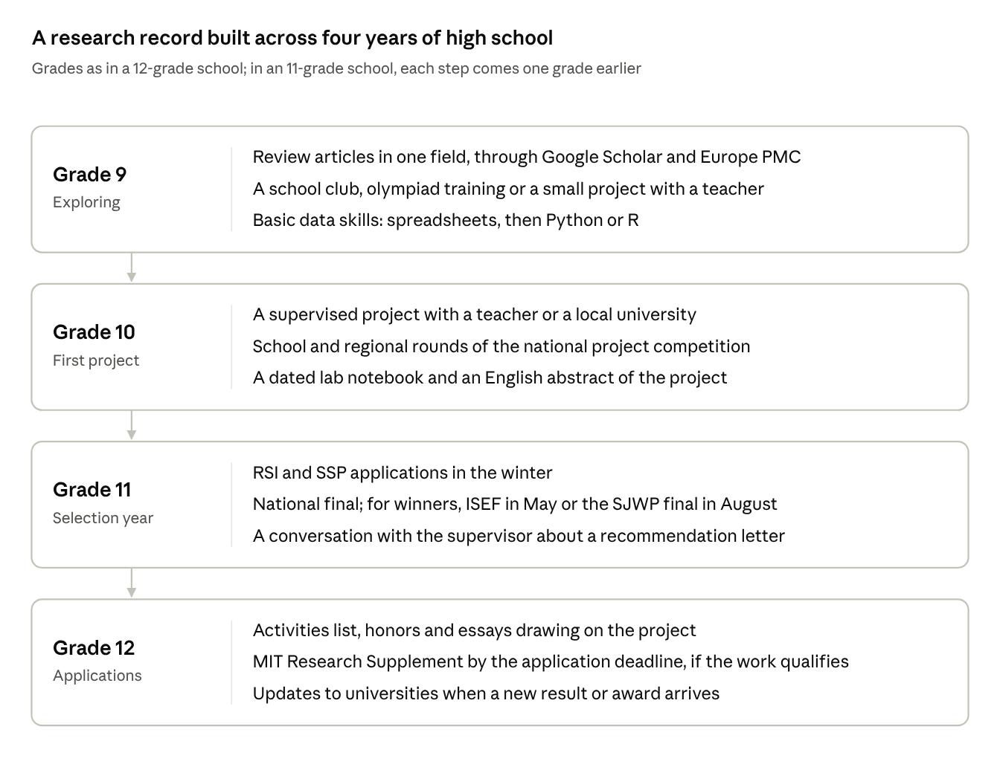

In grade 10 I spent most of a school year on a chemistry project about removing textile dyes from wastewater, and in 2019 it won a second-degree diploma at an international student research competition. In 2026 I reread that paper against the standards of peer-reviewed water treatment journals and found that it lacked most of what a publishable study reports. I have mentored applicants from Kazakhstan and Central Asia since 2021, and this post is written for students like them who are considering a research project before applying to universities abroad.

## My first project

The project compared three ways of removing dyes from four model wastewaters, each made from one class of commercial dye (direct, acid, disperse and reactive): coagulation with iron(III) and aluminum salts, sorption onto sulfonated coal, and the two applied in sequence. A school chemistry teacher and a faculty member of a university chemistry department supervised the work. The paper reported color removal of 66 to 67% for coagulation, 80% for sorption and 98.6% for the two combined.

In September 2026 I wrote a methodological review of the paper against 13 criteria used in the water treatment literature; the review and the original paper are on my [research page](/research/self-audit/). The 2019 design supports one conclusion, that coagulation followed by sorption removed more color than either step alone in all four dye classes. The percentages themselves come from uncalibrated readings taken once per condition, so they show the scale of the effect and cannot serve as performance figures.

## What I would do differently

Each change below comes from a gap the 2026 review found in my 2019 paper, and each applies to a first project in any experimental field.

1. **Calibrate the measurement before collecting data.** I reported optical density at a wavelength the paper never states. A calibration curve from five to seven standards of known concentration converts every reading into mg/L, which another laboratory can compare with its own results.

2. **Measure every condition at least three times.** Every table in my paper has one value per condition. Iron removed 67% of the color and aluminum 66%, and with single readings there is no way to tell whether that one-point gap is a difference between the metals or measurement noise.

3. **Study one system in depth.** I spread the work over four dye classes, each a mixture of two or three dyes with overlapping absorption spectra. One dye of known structure would have given an adsorption capacity in milligrams of dye per gram of sorbent, the number the field uses to compare materials.

4. **Vary the factor the paper calls important.** My paper has a section on the effect of pH on coagulation, and in it pH is only recorded before and after treatment. A jar test across pH 3 to 10 at a fixed dose would have located the working pH for each metal.

5. **Put numbers on the adjectives in the aim.** My aim called the sorbent low-cost. The dose I recorded, 7.9 to 8.8 g per 100 mL of water, equals about 80 kg of sorbent per cubic meter treated, and the paper contains no price calculation.

6. **Read current journal articles.** My 25 sources were Russian-language monographs and handbooks, several published between 1973 and 1996. The kinetic and isotherm models that researchers use to compare sorbents do not appear in the paper.

7. **Keep the raw record.** My lab notebooks and instrument readings from 2018 and 2019 were not available in 2026, so the review could assess only what the paper printed.

8. **Match the problem statement to the evidence.** I opened the paper with pollution of the Irtysh and Ulba rivers in East Kazakhstan. The published measurements I checked in 2026 attribute that pollution mainly to metals from mining and metallurgy, and neither of the two studies I read names textile dyes as a source.

## Routes into research

A high school student outside the US can reach a first project through a school supervisor, a national competition, a selective summer program, a paid online program, or independent work on open data.

| Route                                                | What it provides                                                              | Limits                                                                                                      | Examples                                                                                                                                                                                                   |
|------------------------------------------------------|-------------------------------------------------------------------------------|-------------------------------------------------------------------------------------------------------------|------------------------------------------------------------------------------------------------------------------------------------------------------------------------------------------------------------|
| School project with a teacher and a local university | Laboratory access through the supervisor; a supervisor who can write a letter | Equipment limited to what the school and the department lend; topic often follows the supervisor's own work | My 2019 project                                                                                                                                                                                            |
| National competition that feeds an international one | Judging by scientists; a result that can be looked up                         | Rules and deadlines set by the national organizer; English required at the international stage              | Kazakhstan's national project competition run by the Daryn center, which sends finalists to Regeneron ISEF; the Kazakhstani Junior Water Prize, which sends its winner to the Stockholm Junior Water Prize |
| Selective summer research program                    | A mentor at a research institution; a cohort of students working on projects  | Few places; strict grade and age windows; visa and travel                                                   | RSI, SSP (details in the Resources table)                                                                                                                                                                  |
| Paid online mentorship program                       | A mentor and a schedule for any student who pays                              | Fees; the quality depends on the individual mentor; a completion certificate records attendance             | Fee-based programs vary; the mentor's field and publication record can be checked before paying                                                                                                            |
| Independent computational project on open data       | No laboratory or fee; data and code can be published openly                   | Needs self-discipline and an outside reader to check the methods                                            | Public datasets and literature databases in the Resources table                                                                                                                                            |
{: .data}

Whatever the route, a project is strongest in an application when the student chose or shaped the question, can explain the method step by step, and has a supervisor who can describe the student's part in the work. My own route was the first one. The university supervisor gave access to a department laboratory, and three measurements in the 2026 redesign (surface area by nitrogen adsorption, residual metals by atomic absorption, and isotherms in a thermostatted shaker) need equipment that a school laboratory does not have.

## How research is read in an application

Research gives an admissions reader three kinds of evidence that a transcript does not contain: months of sustained work on one question, a method the student can explain in an interview, and a letter from a supervisor outside the classroom. It is read alongside grades, test scores and English results and does not replace them.

In a US application, research appears in these places:

- **Activities list.** The Common App allows up to 10 activities, each with a 150-character description. A description of my 2019 project in that format: "Tested 3 dye removal methods on 4 model wastewaters, 2018-19; supervised by a university chemist; 2nd-degree diploma at an international competition" (148 characters).

- **Honors.** Competition results go in the Honors section, which has [five places](https://www.collegetransitions.com/blog/should-i-use-the-common-app-additional-information-section/), with the level of the award (school, regional, national, international).

- **Additional Information.** Since the 2025-26 cycle this optional section allows [300 words](https://www.koppelmangroup.com/blog/2025/7/17/2025-2026-additional-information-changes-and-new-challenges-and-circumstances-common-app-section), down from 650, enough for two or three sentences on what a competition is and how many students entered.

- **Research portfolios.** MIT's optional [Research Supplement](https://mitadmissions.org/apply/freshman/supplements) is for a significant project done outside high school classes. It contains a short questionnaire, an abstract or poster (or a citation if the work was published) and a letter submitted directly by the research mentor; it costs $10 through SlideRoom, with fee waivers on request, and is due on the application deadline. One supplement is allowed per applicant.

- **Essays and interviews.** A project gives a student specific material: a result that failed, a measurement that had to be redone, a question that changed.

The wording of a research claim is checked by people who know the field. "Published" means a peer-reviewed journal; a preprint, a school journal and competition proceedings are each named as what they are. An award is listed with its exact name, level and year, and a percentage measured once is reported as a single measurement. My own paper's 98.6% removal figure is an example of a number that reads as a performance result and comes from one uncalibrated reading per condition.

## Notes for international applicants

- **Eligibility.** Some US summer research programs [accept only US citizens and permanent residents](https://www.immerse.education/knowledge-base/15-pre-college-programs-for-international-high-school-students). RSI selects international students through procedures set country by country: its organizer, the Center for Excellence in Education, [chooses the participating countries each year](https://www.cee.org/sites/default/files/documents/apply_to_rsi.pdf), and [roughly a third](https://www.cee.org/sites/default/files/RSIapp/apply_to_rsi1.4.pdf) of participants come from outside the US. The Summer Science Program [accepts international applicants](https://ssp.org/faqs/), does not consider SAT, ACT or AP scores, asks international applicants for English proficiency scores, and offers financial aid to international students.

- **The national route.** Kazakhstan has taken part in Regeneron ISEF as a [national partner since 1999](https://24.kz/ru/news/obrazovanie-i-nauka/768928-kazakhstanskij-shkolnik-poluchil-nagradu-na-prestizhnom-konkurse-v-ssha), and [seven Kazakhstani students](https://www.inform.kz/ru/kazahstanskie-shkolniki-primut-uchastie-vo-vsemirnoy-inzhenernoy-vistavke-v-ssha-5a055eeb) competed at ISEF 2026 in Phoenix. The [Kazakhstani Junior Water Prize](https://www.weproject.media/articles/detail/voda-nauka-budushchee-itogi-respublikanskogo-konkursa-kazakhstani-junior-water-prize/?amp=y), is the national stage of the Stockholm Junior Water Prize; in 2026, its fifth year, more than 70 projects were submitted and 10 teams reached the final.

- **Bolashak.** Since 2026, Kazakhstan's Bolashak scholarship has a [bachelor's category](https://rus.azattyq-ruhy.kz/news/105092-v-kazakhstane-nachalsia-priem-zaiavok-na-programmy-bolashak-i-nauchnye-stazhirovki) for students who placed first to third at international olympiads in school subjects or at international science project competitions, with 20 bachelor's scholarships in 2026.

- **Language.** ISEF [requires project boards and abstracts in English](https://www.societyforscience.org/isef/international-rules/rules-for-all-projects/). My 2019 paper was written in Russian, and the 2026 review describes the study in English so that readers without Russian can assess it. A student whose project is in Kazakh or Russian can add a one-page English abstract that an admissions reader or a judge abroad can read.

- **Context for the reader.** A reader in another country cannot check a competition that has no English-language page. One or two sentences in the Additional Information section giving the organizer, the level and the number of entrants let the reader place the result.

## Warning signs

- **Publication guaranteed for a fee.** A student journal with peer review decides after review. The [Journal of Emerging Investigators](https://emerginginvestigators.org/submissions/pay-and-submit/pay), which publishes research by middle and high school students, charges a $49 submission fee, offers a limited number of fee scholarships, and states that payment does not guarantee publication.

- **A mentor who writes the paper.** Essays and interviews ask the student about the method, and the mentor's letter describes the student's part. A student who cannot explain why each step was done will show it in the first follow-up question.

- **Inflated wording.** "Published" for a preprint, "award" for a participation certificate, "solution" for a laboratory result in a model system. My 2019 paper recommended the process for industrial effluent after testing only prepared dye solutions in clean water.

- **No record of the work.** Raw data, dated notes and analysis files are what a supervisor, a judge or a later reviewer asks for. Competition rules add their own conditions: ISEF [limits a project to 12 months of continuous research](https://www.societyforscience.org/isef/international-rules/rules-for-all-projects/) and makes the student and the adult sponsor responsible for the forms and committee approvals a project needs.

## Timeline by grade

The summer program applications and the national final fall in grade 11, so the first supervised project has to start by grade 10 to have results by then.

## Resources

Programs, competitions and publication options open to students outside the US, as described in November 2026. Dates and rules change each year and are checked on the official page before applying.

| Resource                                                                                                                                  | Type                                                                                                    | Who can take part                                                                                                          | Cost                                                                                                   |
|-------------------------------------------------------------------------------------------------------------------------------------------|---------------------------------------------------------------------------------------------------------|----------------------------------------------------------------------------------------------------------------------------|--------------------------------------------------------------------------------------------------------|
| [Research Science Institute (RSI)](https://cee.org/newsevents/press-releases/applications-being-accepted-2022-research-science-institute) | Six-week summer research program at MIT, [also at Stanford from 2027](https://www.citybiz.co/?p=891652) | Students who have completed the equivalent of three years of high school; international students through country selection | Free to attend                                                                                         |
| [Summer Science Program (SSP)](https://ssp.org/faqs/)                                                                                     | Residential summer research in astrophysics, biochemistry, bacterial genomics and related fields        | High school juniors aged at least 15 and under 19 during the program; international applicants accepted                    | [Free application](https://ssp.org/application/); need-based aid, including for international students |
| [Regeneron ISEF](https://www.societyforscience.org/isef/international-rules/rules-for-all-projects/)                                      | International science and engineering fair                                                              | Grades 9 to 12 or equivalent, under 20 on May 1 before the fair, selected by an affiliated national or regional fair       | Set by the affiliated fair                                                                             |
| [Stockholm Junior Water Prize](https://siwi.org/stockholm-junior-water-prize/participate)                                                 | International competition for water and wastewater projects                                             | Secondary school students aged 15 to 20, nominated by the national organizer                                               | Set by the national organizer                                                                          |
| [MIT Research Supplement](https://mitadmissions.org/apply/freshman/supplements)                                                           | Optional research portfolio in the MIT application                                                      | MIT applicants with a significant project outside class                                                                    | $10; fee waivers on request                                                                           |
| [Journal of Emerging Investigators](https://emerginginvestigators.org/submissions/pay-and-submit/pay)                                     | Peer-reviewed journal for student research                                                              | Middle and high school students                                                                                            | $49 per submission; limited fee scholarships                                                          |
{: .data}

Open literature and data for a project without a university library:

- [Google Scholar](https://scholar.google.com) and [Europe PMC](https://europepmc.org) for searching journal articles, and [Unpaywall](https://unpaywall.org) for finding legal free copies.

- [Our World in Data](https://ourworldindata.org), the [WHO Global Health Observatory](https://www.who.int/data/gho) and [Zenodo](https://zenodo.org) for public datasets.

## Sources

- [Methodological Review and Redesign of My First Research Project, and the 2019 paper](/research/self-audit/)

- [MIT Admissions: portfolios and the Research Supplement](https://mitadmissions.org/apply/freshman/supplements)

- [Summer Science Program: Admissions FAQs](https://ssp.org/faqs/)

- [Summer Science Program: application page](https://ssp.org/application/)

- [Center for Excellence in Education: Applying to RSI (international program)](https://www.cee.org/sites/default/files/RSIapp/apply_to_rsi1.4.pdf)

- [Center for Excellence in Education: Applying to RSI (participating countries)](https://www.cee.org/sites/default/files/documents/apply_to_rsi.pdf)

- [Center for Excellence in Education: RSI applications, 2022](https://cee.org/newsevents/press-releases/applications-being-accepted-2022-research-science-institute)

- [RSI expands to Stanford in 2027](https://www.citybiz.co/?p=891652)

- [Society for Science: Regeneron ISEF rules for all projects](https://www.societyforscience.org/isef/international-rules/rules-for-all-projects/)

- [Stockholm International Water Institute: Stockholm Junior Water Prize, how to participate](https://siwi.org/stockholm-junior-water-prize/participate)

- [Journal of Emerging Investigators: submission fee](https://emerginginvestigators.org/submissions/pay-and-submit/pay)

- [Kazinform: Kazakhstani students at Regeneron ISEF 2026](https://www.inform.kz/ru/kazahstanskie-shkolniki-primut-uchastie-vo-vsemirnoy-inzhenernoy-vistavke-v-ssha-5a055eeb)

- [24KZ: Kazakhstan at Regeneron ISEF since 1999](https://24.kz/ru/news/obrazovanie-i-nauka/768928-kazakhstanskij-shkolnik-poluchil-nagradu-na-prestizhnom-konkurse-v-ssha)

- [WE Project: results of the Kazakhstani Junior Water Prize 2026](https://www.weproject.media/articles/detail/voda-nauka-budushchee-itogi-respublikanskogo-konkursa-kazakhstani-junior-water-prize/?amp=y)

- [Azattyq Ruhy: Bolashak bachelor's category, 2026](https://rus.azattyq-ruhy.kz/news/105092-v-kazakhstane-nachalsia-priem-zaiavok-na-programmy-bolashak-i-nauchnye-stazhirovki)

- [Koppelman Group: Common App Additional Information changes for 2025-26](https://www.koppelmangroup.com/blog/2025/7/17/2025-2026-additional-information-changes-and-new-challenges-and-circumstances-common-app-section)

- [College Transitions: Common App Additional Information and Honors](https://www.collegetransitions.com/blog/should-i-use-the-common-app-additional-information-section/)

- [Immerse Education: pre-college programs for international students](https://www.immerse.education/knowledge-base/15-pre-college-programs-for-international-high-school-students)
